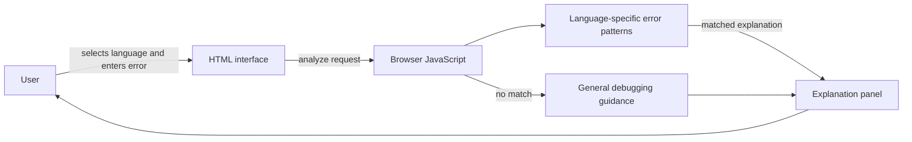

# Traceback Architecture

Traceback is a static, client-side web application. A browser loads the page, styles, and JavaScript directly from the project files. There is no backend, database, external AI service, or build pipeline.

## System overview

All processing takes place locally in the browser. The pasted error message is not uploaded or sent to a service.

## Project structure

| File | Responsibility |
| --- | --- |
| [`index.html`](./index.html) | Page structure, language selector, error input, example buttons, and explanation regions |
| [`styles.css`](./styles.css) | Colors, layout, responsive behavior, and visual states |
| [`app.js`](./app.js) | Error rules, matching, fallback guidance, form interactions, and code-copy behavior |
| [`README.md`](./README.md) | Project overview, usage, and GitHub Pages setup |

## Explanation flow

1. The user selects one of the supported languages and enters an error message.
2. The browser validates that the message is not empty.
3. The app searches the selected language's rules in `app.js`. Each rule combines a regular expression with a plain-language meaning, likely cause, recommended next step, and optional code sample.
4. If a rule matches, its explanation is rendered in the results panel. If no rule matches, the app displays general debugging guidance and labels the result as general.
5. The user may copy an example snippet, try a sample error, or clear the form.

The current rules cover common errors in Python, JavaScript, TypeScript, Java, C++, C#, Go, Rust, and PHP.

## Design boundaries

- **No network dependency:** Explanation matching and rendering are performed locally.
- **No code execution:** The app treats pasted text as an error message; it does not run user-provided source code.
- **Rule-based explanations:** Results depend on the selected language and known message patterns. Unmatched messages receive general guidance, not a claimed diagnosis.
- **Stateless interaction:** Input and explanation are held in the current page session; there is no server-side account or saved history.

## Extending the rules

To add a common error pattern, add a rule to the appropriate language array in `app.js`. A rule should include:

- `pattern`: a regular expression that identifies the error message.
- `meaning`: a brief explanation of what the error says.
- `cause`: a likely reason the error occurs.
- `solution`: practical next steps.
- `example` (optional): a short code sample for the results panel.

Keep patterns specific enough to avoid matching unrelated errors. Test both a representative match and an unrelated message to make sure the general-guidance fallback still works.

## Hosting

Because the project consists of static files, it can be hosted from the repository root with GitHub Pages or any static web host. No server configuration or compilation is required.
